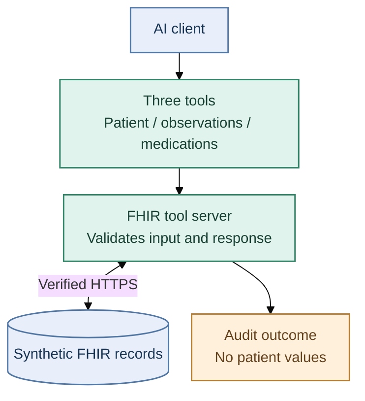

Healthcare / Synthetic data

# Give agents three focused health-data tools.

Read a synthetic patient record, observations or medications through a small, validated interface. Keep sensitive values out of audit logs.

## How it works

[Run the demo](demo.md){ .overview-link }
[Identity-enabled lab](kubernetes-lab.md){ .overview-link }
[Implemented controls and gaps](hipaa-compliance-mapping.md){ .overview-link }

!!! note "Scope"
    Synthetic data only. The demo does not establish clinical consent, SMART authorization or HIPAA compliance.
